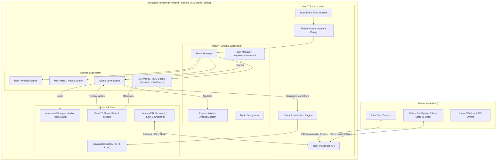

# Architecture Specification

## 1. Executive Summary & Architecture Goals

This document defines the technical architecture, module organization, data flow, and engineering conventions for the 2D Desktop video game developed with **Phaser 4** and **Tauri**.

### Core Architecture Goals

- **Desktop-First Execution:** The application is conceived as a native Desktop executable via Tauri (Rust + Webview), without web browser target dependencies.
- **Separation of Concerns (SoC):** Clear distinction between the game engine (Phaser 4), the native runtime (Tauri), the rendering/map management (Tiled), and pure TypeScript business/state logic.
- **Testability & Determinism:** Isolation of game logic (state machines, math, data wrappers) from Phaser's rendering pipeline, enabling high-coverage unit, integration, and E2E testing.
- **Code Quality & Release Management Assurance:** Built-in static and dynamic validation via ESLint, Prettier, Husky, Commitlint, Changesets, Vitest, Cypress, and integration tests.

---

## 2. Tech Stack Overview

| Layer                      | Technology / Tool               | Module / Role                                                            |
| :------------------------- | :------------------------------ | :----------------------------------------------------------------------- |
| **Runtime Environment**    | Node.js (v26.x)                 | Execution Environment & Package Management                               |
| **Package Manager**        | pnpm                            | Fast, Disk-Efficient Package Management & Dependency Strictness          |
| **Desktop Runtime**        | Tauri (Rust)                    | Native Window Management, File System, OS API, Production Packaging      |
| **Game Engine**            | Phaser 4                        | Scene Lifecycle, Arcade/Custom Physics, Rendering, Input, Sound          |
| **Map Editor**             | Tiled (v1.12+)                  | Tilemap Generation, Collision Masking, Entity Spawning Layers (JSON/TMX) |
| **Build & Bundler**        | Vite                            | HMR Dev Server, Module Bundling, Assets Pipeline, TS Transpilation       |
| **Language**               | TypeScript (Strict)             | Type Safety, Interfaces, Game Models, FSM State Definitions              |
| **Localization**           | i18next                         | Multi-language Support (Italian, English, French, Spanish)               |
| **Testing**                | Vitest                          | Fast Unit & Integration Testing (Game Rules, State, Math, Services)      |
| **Testing**                | Cypress                         | End-to-End (E2E) Testing (UI, Scene Transition, Window Load)             |
| **Code Quality**           | ESLint & Prettier               | Static Analysis, AST Linting, Code Formatting                            |
| **Git Hooks & Versioning** | Husky + Commitlint + Changesets | Pre-commit Checks, Conventional Commits Validation, Automated Changelogs |

---

## 3. System Architecture Diagram

The diagram below illustrates the interactions between native Tauri components, the Vite bundle, the Phaser 4 engine, the i18n subsystem, and data persistence.



---

## 4. Application Layering & Directory Structure

The application follows a strict layered architecture with the `assets` folder located inside `src/` to benefit from Vite's optimization and bundling:

```text
/
├── .changeset/                  # Changesets configuration for Versioning and Changelogs
├── .github/                     # CI/CD Workflows and Copilot configs
├── .husky/                      # Git Hooks (pre-commit, commit-msg)
├── src-tauri/                   # Tauri native Rust code & config
│   ├── tauri.conf.json
│   └── src/
├── src/                         # Frontend Application Source Code
│   ├── assets/                  # Game assets (processed by Vite)
│   │   ├── audio/               # Sound effects and music
│   │   ├── locales/             # Localization JSON files (en, it, fr, es)
│   │   │   ├── en/translation.json
│   │   │   ├── it/translation.json
│   │   │   ├── fr/translation.json
│   │   │   └── es/translation.json
│   │   ├── tilesets/            # Textures and sprite sheets for Tiled
│   │   └── tilemaps/            # Tiled exported maps (.json) + .tiled-project
│   ├── core/                    # Engine-agnostic pure game logic
│   │   ├── fsm/                 # Finite State Machines (Player, Enemies)
│   │   ├── i18n/                # i18next configuration and setup
│   │   ├── models/              # TS Interfaces (Inventory, Power-ups, Stats)
│   │   └── utils/               # Math, helpers, game calculations
│   ├── game/                    # Phaser 4 Integration (Modular Structure)
│   │   ├── config/              # Phaser instance configuration
│   │   ├── entities/            # Extended Sprites / GameObjects (Player, Enemy, PowerUp)
│   │   ├── managers/            # InputManager, SaveManager, SoundManager
│   │   ├── physics/             # Body handling, collisions, special tiles
│   │   └── scenes/              # Phaser.Scene derived classes
│   │       ├── BootScene.ts
│   │       ├── PreloadScene.ts
│   │       ├── MainMenuScene.ts
│   │       ├── GameScene.ts
│   │       └── UIScene.ts
│   ├── services/                # Tauri API Bridge and Persistence (IndexedDB/FS)
│   ├── styles/                  # Container styling CSS
│   └── main.ts                  # Application Entry Point
├── tests/                       # Test Suites
│   ├── unit/                    # Vitest Unit Tests (Core logic, FSM, State)
│   ├── integration/             # Integration Tests (Combined modules, i18n, Parser)
│   └── e2e/                     # Cypress E2E Tests (Bootstrap, Scene Load, Canvas)
├── docs/                        # Project Documentation
├── .changeset/config.json
├── .commitlintrc.json
├── .eslintrc.json
├── .prettierrc
├── cypress.config.ts
├── vite.config.ts
├── vitest.config.ts
└── tsconfig.json

```

---

## 5. Tiled Map Architecture & Layering Standard

Maps created in Tiled (v1.12+) must strictly follow this layer hierarchy (from top to bottom):

1. **Foreground** (Tile Layer): Foreground decorative elements drawn above the player (no collisions).
2. **UI_Triggers** (Object Layer - Optional): Areas triggering screen texts, dialogues, or environmental descriptions.
3. **Entities** (Object Layer): Dynamic object spawning (`PlayerSpawn`, `PowerUp`, `EnemySpawn`, `Door`).
4. **World_Collision** (Tile Layer): Solid level geometry (`collides: true`, bound directly to Phaser's physics engine).
5. **Background_Details** (Tile Layer): Wall-solid background elements without active collisions.
6. **Background** (Tile Layer): Distant backgrounds and optional parallax layers.

---

## 6. Phaser Scene Architecture & Thin Scenes Pattern

- **Thin Scenes:** `Phaser.Scene` classes manage exclusively the graphic engine's lifecycle and delegate complex logic, state machines, and calculations to external classes (`src/core/` or `src/game/entities/`).
- **UIScene:** Parallel scene for HUD, minimap, and reactive UI bound directly to the `i18next` localization engine.

---

## 7. Data Persistence & Storage Architecture

The save system strictly separates global preferences from progression files to respect the Single Responsibility Principle (SRP):

- **Desktop Target (Tauri):** Asynchronous read/write directly on the native File System (`appDataDir`) via Tauri APIs.
- **Web Fallback / Browser Mode:** Use of **IndexedDB** (`localStorage` is strictly excluded due to quota limits and synchronous nature).

---

## 8. Global Configuration Schema (`settings.json`)

All options and systems listed below can be active simultaneously without limits:

```typescript
export interface GlobalSettings {
  language: "it" | "en" | "es" | "fr";
  graphics: {
    displayMode: "fullscreen" | "windowed";
    resolution: { width: number; height: number };
    vsync: boolean;
    screenScaleMode: "integer" | "fit" | "stretch";
    brightness: number; // Float 0.5 - 1.5 applied via WebGL Post-Processing Pipeline
    particleQuality: "low" | "medium" | "high";
    blurQuality: "off" | "low" | "high";
  };
  audio: {
    masterVolume: number; // 0 - 100
    musicVolume: number; // 0 - 100
    sfxVolume: number; // 0 - 100
    runInBackground: boolean;
  };
  controls: {
    preferredInputDevice:
      | "auto"
      | "keyboard"
      | "gamepad_xbox"
      | "gamepad_dualsense"
      | "gamepad_switch";
    aimSensitivity: number;
    keyBindings: Record<string, string>;
    gamepadBindings: Record<string, number>;
  };
  accessibility: {
    uiScale: "small" | "medium" | "large";
    hapticFeedback: boolean;
  };
}
```

---

## 9. Save Slot Data Schema (`SaveSlotData`)

> _Architectural Note:_ Values like `maxHp`, `maxBattery`, and `maxAmmo` are not saved as static values in the JSON file, but are dynamically computed and derived at boot by summing base values with Expansion Kits recorded in the `collectedPickups` array.

```typescript
export interface SaveSlotData {
  metadata: {
    slotId: 1 | 2 | 3;
    playtimeSeconds: number;
    completionPercentage: number;
    lastSavedTimestamp: string; // ISO string
  };
  location: {
    mapId: string; // Current Tiled tilemap ID
    spawnPointId: string; // Last used Save Point ID
    visitedRoomIds: string[]; // Room ID array for Minimap and Fog of War
  };
  playerStats: {
    currentHp: number;
    currentBattery: number; // Battery separated from ammunition (0-100%)
    currentAmmo: Record<string, number>; // Shared / weapon-specific ammunition
  };
  progression: {
    unlockedAbilities: string[]; // Unlocked modules and abilities
    collectedPickups: string[]; // Unique IDs of all collected pickups (prevents respawn)
    worldEvents: string[]; // Triggered levers, buttons, viewed cutscenes
    defeatedBosses: string[]; // Eliminated boss IDs
  };
  statistics: {
    deathCount: number;
  };
}
```
