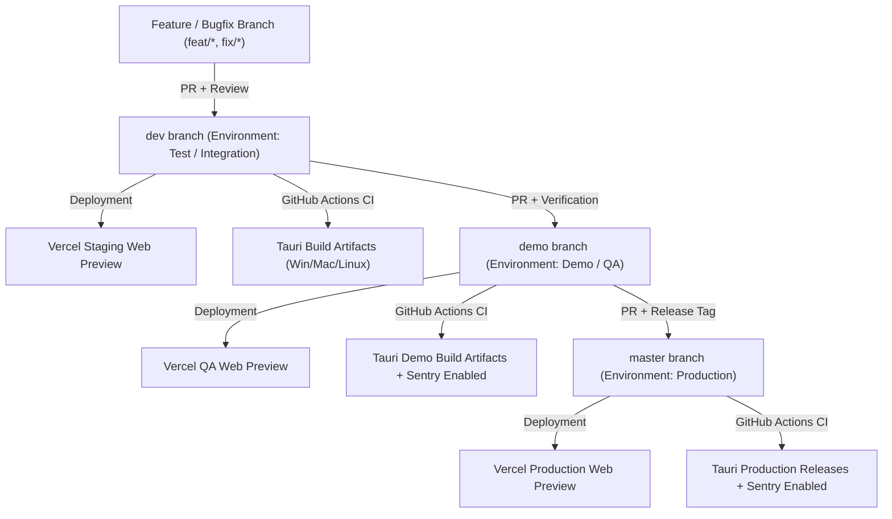

# Product Vision & Strategy Document

## 1. Product Overview & Vision Statement

### Vision Statement

To create a memorable 2D action/exploration video game experience delivered as a **native Desktop application** (Windows, macOS, Linux) powered by **Tauri** and **Phaser 4**. The application blends classic retro-game feel with modern performance, native multi-language support, automated multi-slot save management, and full support for both desk and couch control setups (Gamepad, Keyboard, Mouse).

### Product Objectives

- **Cross-Platform Desktop Native:** Ensure lightweight, performant, and self-contained executables for **Windows, macOS, and Linux** compiled via automated CI/CD pipelines in GitHub Actions.
- **Accessibility & Localization:** Deliver an out-of-the-box localized experience in **Italian** and **English**, with built-in readiness for **French** and **Spanish** via `i18next`.
- **Robustness & Monitoring:** Maintain high production stability in `master` and test builds in `demo` by integrating remote error tracking with **Sentry**.
- **Quality-Driven & Agile Evolution:** Adopt a rigorous _Docs-as-Code_ approach where every feature corresponds to a **GitHub Issue**, tracked via **User Story** and validated through **Pull Requests** and automated test suites (Vitest and Cypress).

---

## 2. Target Audience & User Personas

### Target Principal

- **PC / Desktop Gamers:** Enthusiasts of 2D platformers, action games, and exploration titles on PC, Mac, and Linux.
- **Gamepad & Steam Deck / Handheld PC Users:** Players who prefer controller-based couch gaming or portable handheld devices running Linux or Windows.

### User Personas

#### Persona 1: Marco - "The Casual / Desktop Gamer"

- **Age:** 28
- **Platform:** Windows 11 / macOS
- **Hardware:** Laptop or Desktop PC with Keyboard/Mouse or Xbox Gamepad.
- **Needs:**
- Wants fast game startup times without lengthy loading screens.
- Expects their native language (Italian) to be supported out of the box.
- Relies on dependable, multi-slot save games to resume sessions at different times or share progression with family members.

#### Persona 2: Alex - "The Retrogaming & Linux Enthusiast"

- **Age:** 34
- **Platform:** Ubuntu / Arch Linux / Steam Deck
- **Hardware:** DualSense / Switch Pro Controller / Handheld.
- **Needs:**
- Demands a lightweight native Linux executable (AppImage / DEB) that does not consume excessive background resources.
- Requires flawless Gamepad support with immediate response and zero complex manual configurations.
- Values stability and abhors unexpected crashes during extended gaming sessions.

---

## 3. Target Platforms, Requirements & Distribution

### Supported Desktop Platforms

| OS          | Tauri Build Format                     | Architectures                        |
| ----------- | -------------------------------------- | ------------------------------------ |
| **Windows** | `.msi` / `.exe` (Installer & Portable) | x64                                  |
| **macOS**   | `.dmg` / `.app`                        | Apple Silicon (M1/M2/M3) & Intel x64 |
| **Linux**   | `.AppImage` / `.deb`                   | x64                                  |

### Web Previews (Vercel)

- **Demo / Staging Web Previews:** Automatic deployment of Web-rendered Vite builds on **Vercel** for rapid browser-based testing by QA, testers, and stakeholders during development.

### Minimum Hardware Requirements (Indicative)

- **OS:** Windows 10+, macOS 11+, Ubuntu 20.04+ (or equivalent Linux distribution).
- **CPU:** Dual Core x64 / ARM64 processor.
- **RAM:** 2 GB RAM.
- **Graphics:** GPU supporting WebGL 2.0 / recent integrated graphics.
- **Storage:** ~200 MB available disk space.
- **Input:** Gamepad (XInput / DirectInput / DualShock / DualSense / Switch Pro), Keyboard, Mouse.

---

## 4. Environments, Branch Mapping & Delivery Pipeline

The product lifecycle is divided into 3 primary environments mirrored by dedicated Git branches:

